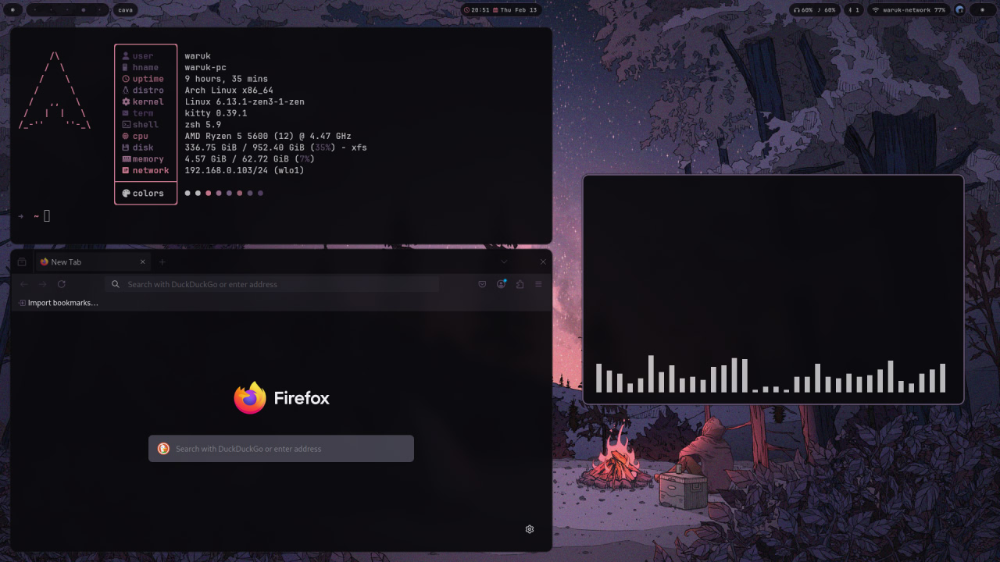

Hyprland 0.57+ (Lua configuration), verified with 0.57.2.

The entry point is `config/hypr/hyprland.lua`. Edit `binds.lua`,
`input.lua`, `lookandfeel.lua` and `monitors.lua` for your setup.
Hyprlock still uses `hyprlock.conf` and the existing pywal Hyprlang template.

`colors.lua` reads pywal colors with a fallback palette before the first
wallpaper is generated. `wallpaper.sh [image]` regenerates the palette and
reloads Hyprland to update the borders. It requires pywal16, awww and
swaynotificationcenter. Screenshots need grim and wl-clipboard; media keys
need playerctl, wpctl and brightnessctl. Default apps: kitty, Firefox,
Nautilus and rofi.

To apply this local copy (back up your existing configuration first):

```sh
cp -a config/hypr/. ~/.config/hypr/
cp -a config/wal/. ~/.config/wal/
Hyprland --verify-config -c ~/.config/hypr/hyprland.lua
```

Log in to Hyprland again to run autostart; in an existing session,
`hyprctl reload` only reloads settings and shortcuts.
Official API reference: https://wiki.hypr.land/configuring/


waruk hyprland dots



INSTALLATION

```sh
. <(wget -qO- https://raw.githubusercontent.com/wxruk/warukdots/refs/heads/main/install.sh)
```

```sh
. <(wget -qO- https://waruk.xyz/install.sh)
```

TODO

1. gtk and qt pywal 

2. autoinstall pywalfox

thanks to:
https://github.com/uZer/pywal16.nvim for pywal neovim colors
